

  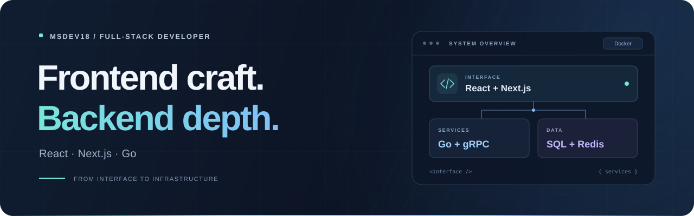

  I work across the stack with <strong>React, Next.js, and Go</strong>. 
  My focus: thoughtful interfaces, clear service boundaries, and well-structured data.

  <a href="https://github.com/MsDev18?tab=repositories"><strong>Explore my repositories ↗</strong></a>

## Tech stack

### Frontend

  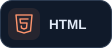
  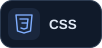
  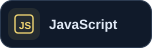
  
  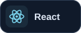
  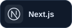

### Backend & architecture

  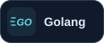
  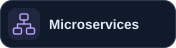
  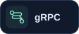

### Data & infrastructure

  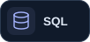
  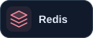
  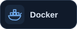

## Engineering focus

| Area | What I focus on |
| :--- | :--- |
| **Interfaces** | Responsive layouts, reusable React components, and Next.js applications. |
| **Services** | Go development, microservice architecture, and communication with gRPC. |
| **Data** | SQL database design, relational data modeling, and caching with Redis. |
| **Delivery** | Docker containers and consistent development environments. |

I also work with **PostgreSQL**, **MySQL**, **MongoDB**, **REST APIs**, **WebSockets**, and **TCP/IP networking**.

---

  Thoughtful interfaces. Clear boundaries. Code that stays understandable.

